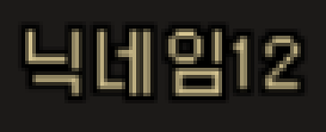
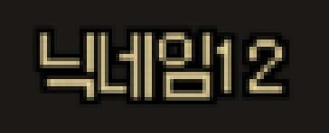

# dnf-ocr-synth

닉네임을 OCR 학습용 이미지로 만드는 Python 패키지입니다.

아래는 `MWmwgjI1O456`의 실제 게임 화면과 렌더링 결과입니다. 돋움·1920×1080·UI 0% 기준으로, 두 이미지를 4배 확대했습니다. 이 샘플은 배경을 제외한 글자와 검은 테두리가 픽셀 단위로 일치합니다.

| 실제 게임 화면 | 렌더링 결과 |
| --- | --- |
|  |  |

## 설치 및 실행

Python 3.11 이상이 필요합니다. 저장소 폴더에서 다음 명령을 실행합니다.

```powershell
python -m pip install -e .
python -m dnf_ocr_synth '닉네임' --gulim 'C:/Windows/Fonts/gulim.ttc' --ui-percent 100 --output output/dotum.png
python -m dnf_ocr_synth '닉네임' --profile nanum-neo --batang 'C:/Windows/Fonts/batang.ttc' --nanum 'C:/fonts/NanumSquareNeoOTF-cBd.otf' --ui-percent 100 --output output/nanum.png
```

나눔스퀘어 네오의 경로는 폰트를 저장한 위치에 맞게 바꿔 주세요. 설치 후에는 `python -m dnf_ocr_synth` 대신 `dnf-ocr-synth` 명령으로 실행해도 됩니다.

Python 코드에서는 다음과 같이 사용합니다.

```python
from pathlib import Path

from dnf_ocr_synth import FontPaths, Renderer, estimate_ui_scale

renderer = Renderer(
    FontPaths(
        gulim=Path("C:/Windows/Fonts/gulim.ttc"),
        batang=Path("C:/Windows/Fonts/batang.ttc"),
        nanum=Path("C:/fonts/NanumSquareNeoOTF-cBd.otf"),
    )
)
sample = renderer.render(
    "닉네임",
    profile="dotum",
    scale=estimate_ui_scale(100, client_height=1080),
)
sample.save("nickname.png")

# sample.image: 생성한 RGBA 이미지
# sample.native_mask: 확대 전 글자 모양을 나타내는 마스크
# sample.metadata["text"]: OCR 정답으로 사용할 닉네임
```

`FontPaths`에 사용할 폰트의 파일 경로를 추가합니다

- 돋움 모드(`dotum`)는 `gulim.ttc`를 사용합니다. 한자가 포함되면 `batang.ttc`도 필요합니다.
- 나눔스퀘어 네오 모드(`nanum-neo`)는 `NanumSquareNeoOTF-cBd.otf`를 사용합니다. 한자나 이 파일에 없는 문자를 그릴 때는 `batang.ttc`도 필요합니다.


## 렌더링 옵션

| 옵션 | 설명 |
| --- | --- |
| `profile="dotum"` | 돋움 |
| `profile="nanum-neo"` | 나눔스퀘어 네오 |
| `layout="metrics"` (기본값) | 한자는 게임 화면에서 확인한 간격을 적용합니다. 그 밖의 문자는 폰트의 글자 폭과 기준선에 따라 배치합니다. |
| `color` / `--color R G B` | 글자색을 RGB로 지정합니다. 각 값은 0~255의 정수이며, 기본값은 `(75, 209, 255)`입니다. |
| `scale` / `--scale` | 글자를 이미지로 만든 뒤 지정한 배율을 적용합니다. 0 ~ 16 |
| `--ui-percent` | 게임의 UI 크기 설정에 맞춰 배율을 추정합니다. `--scale`과 함께 사용할 수 없습니다. |
| `scale_model` / `--scale-model` | 배율을 적용하는 방식입니다. 기본값 `affine-bilinear`는 0.1.2와 같은 이미지를 만들고, `calibrated-v1`은 게임 화면에서 잰 확대 방식을 씁니다. 아래 "UI 배율 확대 모델"을 참고하세요. |

예를 들어 실행 명령에 `--color 255 255 255`를 붙이면 글자를 흰색으로 그립니다. Python에서는 `renderer.render("닉네임", color=(255, 255, 255))`처럼 지정합니다.

한자는 두 모드 모두 `batang.ttc`의 12px 비트맵을 사용하며, 획을 추가로 굵게 만들지 않습니다. 돋움은 글자의 획이 차지하는 가로 폭에 1px을 더한 만큼 다음 글자로 이동하고, 나눔은 11px씩 이동합니다. `一`처럼 폭이 좁은 한자도 이 규칙을 따릅니다. 글자별 기준선 위치와 높이를 유지하므로 `電`의 아래쪽 획도 잘리지 않습니다.

1920×1080, UI 0%의 `汞一電進龍` 스크린샷에서 글자색과 검은 1px 외곽선이 일치하는 것을 확인했습니다. UI 배율이 1보다 클 때의 차이와 측정 결과는 아래 "UI 배율 확대 모델"에 정리했습니다. 한글·일본어·특수문자가 섞인 닉네임의 전체 배치는 아직 검증하지 않았습니다.

돋움 모드에서 한자를 그리는 예제입니다.

```powershell
python -m dnf_ocr_synth '汞一電進龍' --gulim 'C:/Windows/Fonts/gulim.ttc' --batang 'C:/Windows/Fonts/batang.ttc' --ui-percent 0 --output output/hanja.png
```

## UI 배율 확대 모델

게임은 UI 배율 s가 1보다 크면 확대 전 글자(돋움 11px와 1px 외곽선)를 화면 배율에 맞춰 늘려 그립니다. 기본 방식인 `affine-bilinear`는 이 확대를 Pillow의 bilinear 변환으로 흉내 내며, 0.1.2의 출력과 픽셀이 같습니다. 이 방식은 게임보다 획 가장자리가 흐립니다.

`calibrated-v1`은 공대 상세 창의 이름 칸을 실제로 캡처해 잰 확대 방식입니다.

- 확대: 확대 전 픽셀 단위로 잰 x, y 분리형 커널(0.125px 간격 21 tap, 2.5px까지)을 모든 배율에 함께 씁니다. s = 1이면 커널 없이 확대 전 이미지를 그대로 씁니다.
- 배치: 한글은 글자의 잉크 폭 + 1px씩, ASCII 기호는 돋움체 글리프로, `♥` 같은 ASCII가 아닌 기호는 기준선보다 1행 아래에 놓습니다. 영문과 숫자는 기본 방식과 같습니다.
- 출력: 커널이 외곽선 밖 2.5px까지 닿으므로 여백이 3px입니다. 커널은 일부 픽셀에서 1을 넘거나 음수가 되는데, RGBA로 저장할 때는 투명도를 0~1로 자릅니다.
- 범위: 확대 전보다 작게 줄이는 배율(s < 1)은 측정하지 않았으므로 오류로 거부합니다.

아래는 합성 텍스트 `닉네임12`를 공대 창의 일반 행 글자색으로 s = 1.8에서 그려 4배로 확대한 것입니다.

| `affine-bilinear` | `calibrated-v1` |
| --- | --- |
|  |  |

커널은 공대 세 곳의 캡처로 정한 뒤 고정했고, 처음 보는 공대 두 곳의 선명한 캡처 33장(1067×600~1924×1082, UI 100%, s 1.0~1.8)으로 확인했습니다. 지표는 이름 칸을 던삐삐의 공대 닉네임 이진화로 흑백으로 바꾼 뒤 실제 화면과 다른 픽셀 수를 글자 픽셀 수로 나눈 값입니다. 글자 위치는 칸마다 서브픽셀 단위로 맞춘 뒤 비교했습니다.

| 방식 | s > 1 전체 | s 구간별 |
| --- | --- | --- |
| `calibrated-v1`의 커널 | 1.65% | 0.54~3.03% |
| 2배 nearest 뒤 bilinear(비교용, 패키지에 없음) | 2.90% | 1.86~4.01% |

s = 1에서는 두 방식 모두 다른 픽셀이 없습니다. 구간별로 2%를 넘는 곳(s 1.0x, 1.1, 1.7)이 남아 있습니다. 그중 s 1.0x, 1.1의 초과분은 대부분 숫자 뒤의 넓은 간격 때문에 이진화가 이름을 두 덩어리로 나눈 칸에서 나왔고, 비교 방법의 한계입니다. 숫자의 위치 자체는 게임과 같습니다.

`geometry.name_crop_geometry(scale, row, heading)`는 던삐삐가 공대 창 `row`(1~12)의 이름 칸을 자르는 위치와 크기를 돌려줍니다. s = 1에서 86×17px이고, 그 밖의 배율에서는 공대 창의 위치에 따라 1px씩 달라집니다. `name_text_left(width)`는 확대 전 폭이 `width`인 이름이 86px 칸에서 시작하는 위치입니다.

PNG 메타데이터의 `schema_version`은 2이며, `scale_model`(이름, 배치 방식, 커널 tap)과 방식에 맞는 `resampling`, `padding_px`가 들어갑니다.

## 닉네임 검사

```python
from dnf_ocr_synth import validate_nickname

result = validate_nickname("닉네임")
assert result.is_valid and result.byte_length == 6

result = validate_nickname("MyGM", banned_words=["gm"])
assert not result.is_valid
```

- CP949로 표현할 수 있는 닉네임을 검사합니다. 최대 길이는 12바이트이며, ASCII 문자는 1바이트, 그 밖의 지원 문자는 2바이트로 계산합니다.
- 입력이 비어 있거나 공백, 제어문자, 보이지 않는 문자, CP949로 표현할 수 없는 문자가 포함되어 있으면 검사에 실패합니다. 입력한 문자열을 자동으로 수정하지 않습니다.
- 금칙어를 검사하려면 `banned_words`에 추가합니다. 대소문자는 구분하지 않으며, 닉네임의 일부가 금칙어와 일치해도 검사에 실패합니다.
- 빈 값, 공백, 사용할 수 있는 문자, 바이트 길이, 금칙어 순서로 검사합니다. 결과에는 통과 여부(`is_valid`), 실패 이유(`reason`), 계산할 수 있는 경우 바이트 수(`byte_length`)가 담깁니다.
- `Renderer.render()`도 닉네임 형식을 검사합니다. 형식에 맞지 않거나 폰트에 없는 문자가 포함되어 있으면 오류가 납니다. 금칙어도 확인하려면 이미지를 만들기 전에 `validate_nickname()`으로 검사합니다.

이 검사는 입력 형식만 확인합니다. 게임에서 실제로 생성할 수 있는 이름인지, 이미 사용 중인 이름인지는 확인하지 않습니다.

앞에서 만든 `renderer`로 여러 닉네임의 이미지를 만들고, 파일 이름과 정답을 JSONL에 저장하는 예제입니다. 이미지 파일 이름에는 닉네임 대신 순번을 붙입니다.

```python
import json
from pathlib import Path

output = Path("output")
output.mkdir(exist_ok=True)
with (output / "labels.jsonl").open("w", encoding="utf-8") as manifest:
    for index, text in enumerate(["검신", "★검신★", "ァ검신★"]):
        sample = renderer.render(text, profile="dotum", scale=1.8)
        filename = f"{index:06d}.png"
        sample.save(output / filename)
        record = {"image": filename, **sample.metadata}
        manifest.write(json.dumps(record, ensure_ascii=False) + "\n")
```

PNG에도 입력한 닉네임과 생성에 사용한 정보를 저장합니다. 여기에는 글자별 폰트, 다음 글자까지 이동하는 거리(`glyphs[].advance_px`, 확대 전 픽셀), 배율, 폰트 파일의 SHA-256, Pillow·FreeType 버전 등이 포함됩니다.

이 정보는 `dnf_ocr_synth`라는 키에 JSON으로 들어 있습니다. 

```python
import json

from PIL import Image

with Image.open("nickname.png") as image:
    metadata = json.loads(image.info["dnf_ocr_synth"])
    assert metadata["text"] == "닉네임"
```

## 개발 및 테스트

```powershell
python -m pip install -e '.[dev]'
$env:DNF_SYNTH_NANUM = 'C:/fonts/NanumSquareNeoOTF-cBd.otf'
python -m unittest discover -s tests -v
python -m ruff check .
python -m ruff format --check .
python -m build
```

## 사용하는 폰트

아래 세 파일을 사용합니다. **저장소에는 폰트 파일이 들어 있지 않습니다.** 각 폰트의 사용 조건을 확인한 뒤 직접 준비해야 합니다.

| 파일 | 사용하는 글꼴 | 용도 | 준비 방법 |
| --- | --- | --- | --- |
| `gulim.ttc` | 돋움, 글꼴 번호 2 | 돋움 모드에서 닉네임을 그릴 때 사용합니다. | Windows에 설치된 `C:/Windows/Fonts/gulim.ttc`를 사용합니다. |
| `batang.ttc` | 궁서, 글꼴 번호 2 | 두 모드의 한자와 나눔스퀘어 네오에 없는 `ァ`, `ぎ` 등의 문자를 그릴 때 사용합니다. | Windows에 설치된 `C:/Windows/Fonts/batang.ttc`를 사용합니다. |
| `NanumSquareNeoOTF-cBd.otf` | 나눔스퀘어 네오 Bold | 나눔스퀘어 네오 모드에서 사용합니다. | [네이버 공식 배포처](https://campaign.naver.com/nanumsquare_neo/)에서 준비합니다. |

TTC 파일에는 여러 글꼴이 들어 있습니다. `gulim.ttc`에서는 돋움을, `batang.ttc`에서는 궁서를 선택합니다. 표의 글꼴 번호는 파일 안에서 글꼴을 구분하는 `face index`입니다.

나눔스퀘어 네오에 없는 문자를 궁서로 그리는 방식은 `ァÐぎ★` 샘플을 비교해 정했습니다. 해당 문자는 궁서와 궁서체의 12px·13px에서 같은 모양으로 나왔습니다. 따라서 게임이 실제로 어떤 글꼴과 크기를 사용하는지, 다른 문자도 같은 방식으로 처리하는지는 아직 확인하지 못했습니다.

한자는 `汞一電進龍` 샘플로 바탕 파일 쪽 비트맵과 일치하는 것을 확인했습니다. 이 파일 안의 네 글꼴은 해당 한자들의 12px 비트맵이 같으므로, 게임이 어느 글꼴을 선택했는지까지 구분한 것은 아닙니다. 일본어 등에 적용하던 굵기 보정은 한자에 적용하지 않습니다.

## 폰트 보관과 라이선스

- 폰트 파일은 각자 사용하는 컴퓨터에 보관합니다. 폰트 파일과 `fonts/local/` 폴더는 Git에 올라가지 않도록 `.gitignore`에 등록되어 있습니다.
- Windows 폰트는 Windows에 설치된 파일을 읽어서 사용합니다. 저장소, 배포 파일, 컨테이너에는 넣지 않습니다. 자세한 내용은 [Microsoft 폰트 재배포 안내](https://learn.microsoft.com/en-us/typography/fonts/font-faq)를 확인해 주세요.
- 나눔스퀘어 네오는 OFL 1.1로 배포되지만, 이 저장소에는 폰트 파일을 포함하지 않습니다. 사용 조건은 [네이버 나눔글꼴 라이선스](https://help.naver.com/service/30016/contents/18088?osType=PC&lang=ko)를 확인해 주세요.
- 닉네임을 그린 PNG와 글자별 이미지를 모아 만든 비트맵 폰트는 배포 조건이 다릅니다. 글자별 이미지 묶음은 저장소에 포함하지 않습니다.
